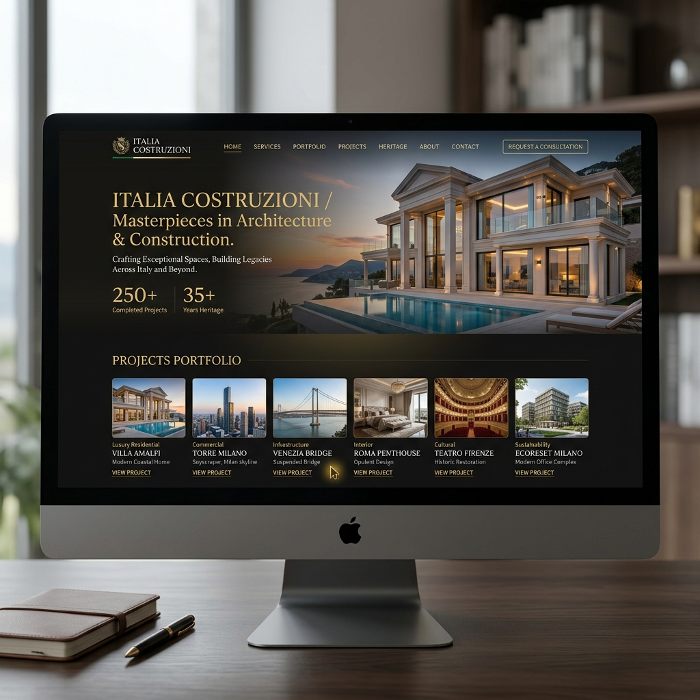
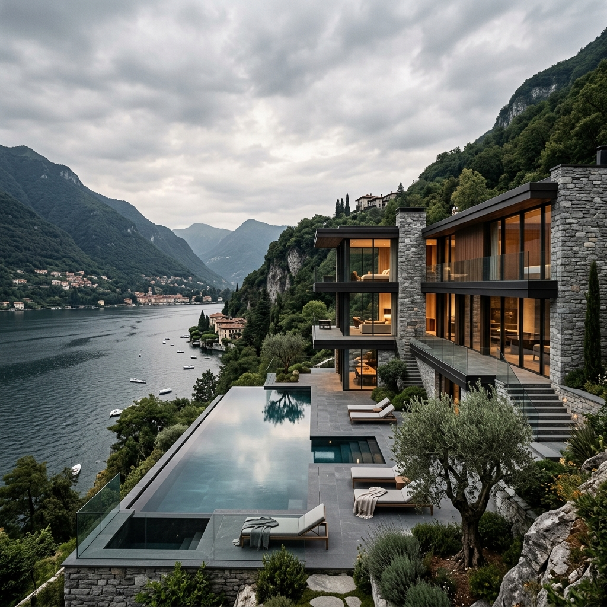
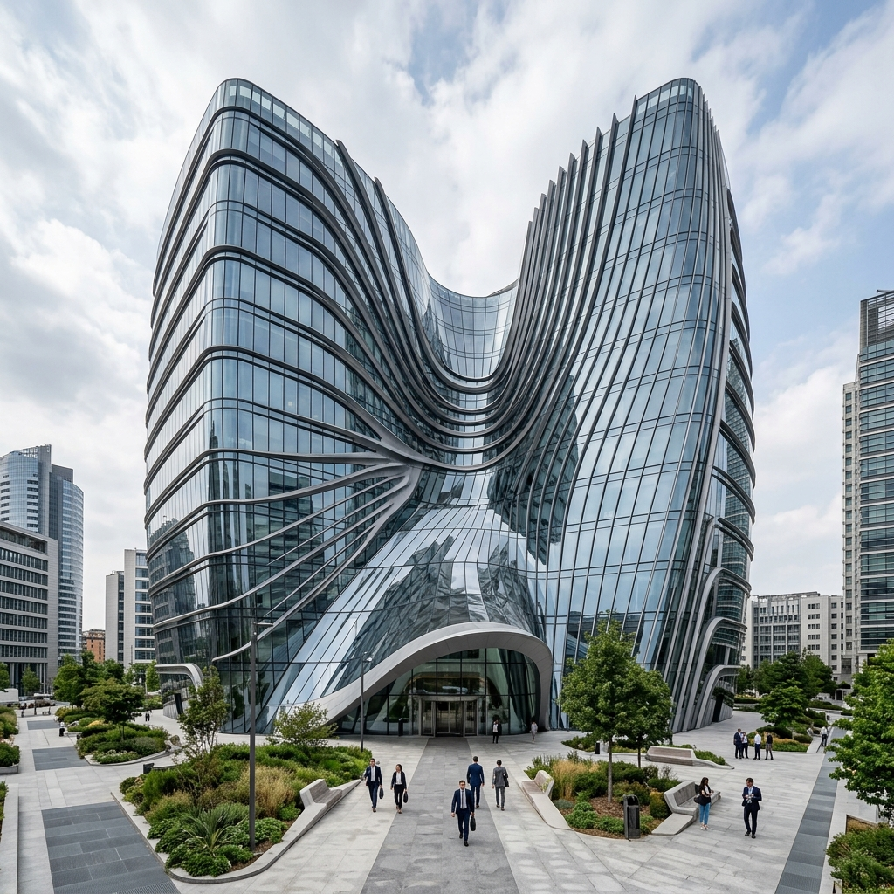

# 🏛️ Italia Costruzioni

<div align="center">

  

  ### *Elevating Italian Architectural Craftsmanship & Engineering Excellence*

  [](https://react.dev/)
  [](https://www.typescriptlang.org/)
  [](https://vitejs.dev/)
  [](https://tailwindcss.com/)
  [](https://www.framer.com/motion/)

  [Overview](#-overview) • [Website Screenshots](#-website-screenshots) • [Key Features](#-key-features) • [Tech Stack](#-tech-stack) • [Getting Started](#-getting-started)

</div>

---

## 🌟 Overview

**Italia Costruzioni** is a state-of-the-art corporate digital portal designed for a premier luxury construction & engineering firm operating in Italy. The application combines bespoke architectural aesthetic design with interactive smooth micro-animations, showcasing residential villas, corporate complexes, and major infrastructure projects.

---

## 📸 Website Screenshots & Portfolio Showcase

<div align="center">

### 🏡 Luxury Residential Projects

*Exclusive modern villas and private estates designed with contemporary Italian elegance.*

<br/>

### 🏢 Commercial & Corporate Complexes

*High-rise headquarters, retail centers, and urban commercial hubs built to environmental standards.*

<br/>

### 🌉 Civil & Infrastructure Engineering

*Bridges, transit networks, and large-scale public engineering projects built for generations.*

</div>

---

## ✨ Key Features

- **🏛️ Luxury Corporate Experience:** Sleek dark-mode aesthetic paired with refined typography and golden accent highlights.
- **⚡ Fluid Dynamic Animations:** Powered by `framer-motion` for spring-based scroll reveals, custom cursors, parallax effects, and smooth layout shifts.
- **📊 Interactive Animated Counters:** Real-time animated statistics tracking completed projects, years of heritage, and client satisfaction.
- **🏗️ Architectural Project Showcase:** Detailed gallery presenting Residential, Commercial, and Infrastructure flagship projects with modal details and filtering.
- **🛠️ Comprehensive Services Suite:** Interactive tabs covering architectural design, structural engineering, luxury restorations, and project management.
- **📱 Ultra-Responsive & Mobile Optimized:** Pixel-perfect layout tailored for mobile devices, tablets, and wide desktop displays.
- **📩 Lead Generation Form:** High-converting contact section integrated with custom form handling and validation state feedback.

---

## 🛠️ Tech Stack

| Technology | Purpose |
| :--- | :--- |
| **[React 19](https://react.dev/)** | Frontend UI Library & Component State Management |
| **[TypeScript](https://www.typescriptlang.org/)** | Strict Static Type Safety & Developer Ergonomics |
| **[Vite](https://vitejs.dev/)** | Next-Generation Frontend Tooling & Blazing Fast HMR |
| **[Tailwind CSS v4](https://tailwindcss.com/)** | Modern Utility-First CSS Engine |
| **[Framer Motion](https://www.framer.com/motion/)** | Production-Ready Declarative Animations |
| **[Phosphor Icons](https://phosphoricons.com/)** | Flexible & Clean Icon System |

---

## 🚀 Getting Started

Follow these instructions to set up and run the project locally on your machine.

### Prerequisites

Make sure you have **Node.js** (v18 or higher recommended) and **npm** installed.

### Installation

1. **Clone the repository:**
   ```bash
   git clone https://github.com/syedasjadabbas/italian-construction-website.git
   ```

2. **Navigate into the project directory:**
   ```bash
   cd italian-construction-website
   ```

3. **Install dependencies:**
   ```bash
   npm install
   ```

4. **Start the local development server:**
   ```bash
   npm run dev
   ```

5. **Build for production:**
   ```bash
   npm run build
   ```

---

## 🎨 Design Philosophy

> *"Architecture is frozen music. Our digital presence should feel as balanced, enduring, and inspiring as the structures we build."*

- **Precision & Structure:** Clean alignment, balanced white space, and rigid grid layouts inspired by structural architectural blueprints.
- **Luxury Aesthetics:** Deep neutral backgrounds contrasted with warm metallic hues reflecting Italian marble and travertine.
- **Confidence & Heritage:** Built to establish instant trust with high-net-worth individuals, investors, and municipal partners.

---

<div align="center">

Crafted with ❤️ for **Italia Costruzioni** by [Syed Asjad Abbas](https://github.com/syedasjadabbas)

</div>
